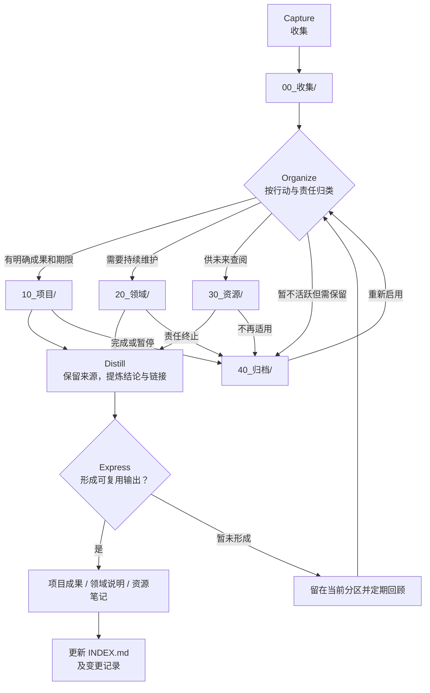

# 本库规划

本文件说明目标、管理范围与组织方法。主要内容入口见 [[INDEX]]；具体执行约束见 [[AGENT]]。

## 目标

本库称为“智能体库”，以 Git 根目录为 Obsidian vault 根目录，面向 Agent 收集、组织、提炼和输出 Git、开发工具、Vibe Coding、知识管理与 Copilot 能力生态的资料。按行动与责任组织信息，而不只按主题堆叠；保留可追溯的来源与上下文。

## 两库称呼与分工

| 称呼 | 对应对象 | 编辑主体与职责 |
|---|---|---|
| 智能体库 | 当前工作区 `data_Git_Local` | 以 Agent 为主要编辑主体，维护知识、方法、规则、工具能力与管理记录，为个人知识库的整理维护提供辅助 |
| 个人知识库 | 外部 `data_Lgx` | 以用户为主要编辑主体，由用户每日更新与输入；Agent 借助智能体库辅佐整理维护，不替代用户的内容输入与判断 |

两库是协作关系，不是新旧替代关系，也不默认合并或相互复制个人内容。文档中的“本库”“当前库”指智能体库；“原库”指个人知识库，不表示它已停用或将被替代。

## 管理范围

- 智能体库资料与能力管理：通用资料按 PARA 存放；Copilot 能力的跨工作区、用户配置、扩展、会话与组织/远程来源管理，由 [[20_领域/AgentHarness管理/管理总览]] 承接。
- 个人知识库辅助整理维护：长期职责归 [[20_领域/知识管理/个人知识库维护]]，有明确成果和结束条件的一轮改进另立项目；当前阶段见 [[10_项目/个人知识库首轮整理/项目总览]]，具体任务、方案与验收留在项目记录中，实际整理成果仍以个人知识库为主要落点。

## 工作方法

CODE 是处理信息的流程，PARA 是信息的存放位置，两者配合使用：

| CODE 阶段 | 做法 | 对应位置或结果 |
|---|---|---|
| Capture（收集） | 快速保存新想法、链接和待处理资料 | `00_收集/` |
| Organize（组织） | 根据当前行动和责任归入 PARA | `10_项目/`、`20_领域/`、`30_资源/`、`40_归档/` |
| Distill（提炼） | 保留来源，提取结论、关键词、属性和关联链接 | 对应 PARA 笔记及索引 |
| Express（表达） | 将知识用于项目、说明、方案或其他交付物 | 按用途放在对应项目、领域或资源中，并从 [[INDEX]] 导航 |

| PARA 分区 | 判定方式 | 生命周期 |
|---|---|---|
| Projects（项目） | 有明确结果和完成条件的阶段工作 | 完成或暂停后移入归档 |
| Areas（领域） | 需要持续维护、没有固定结束日期的责任 | 持续维护，失效后归档 |
| Resources（资源） | 供未来参考的主题、工具、方法和资料 | 有用时保留，无用时归档 |
| Archives（归档） | 当前不再行动但需要保留的项目、领域或资源 | 保留来源与历史，不直接删除 |

会话中出现没有落点的主题时，先检索现有内容和归属，再按上表判断是否需要新增项目、领域或资源笔记；主题本身不等于项目或领域。归属不明的内容先收集，不为占位预建空目录，也不把会话摘要当作长期存放位置。

## 正文与过程

每个具体项目、领域或资源主题采用轻量分区，不在 PARA 大分区下集中拆开所有主题：

| 位置 | 承载内容 |
|---|---|
| 主题目录中的正文 | 面向阅读、使用或当前管理的报告、说明、方法与状态；原有主题分类子目录可以保留 |
| 按需增加的过程目录 | 支撑正文形成的草稿、试验、材料、清单与核验证据；已有职责清楚的目录沿用，不再套一层同义目录 |

- 内容少时先用总览或索引区分入口，有实际材料再增加 `过程/`；不强制建立输出区、维护区、缓存区或空目录。
- 输出不等于最终交付：项目专用说明归项目，长期维护的指南归领域，可独立复用的教学与概念资料归资源；仅供当前推演或佐证的内容留在过程。
- 总览链接可读正文与过程入口，细目只在最近一级入口登记，[[INDEX]] 按根文件与分区收主要导航；完整结构另见 [[90_系统/流程图/本库目录树|按需刷新的目录快照]]。同一正文只维护一份。分区表示用途，不替代确认状态；待确认方法、候选方案与已生效规则仍须区分。

## CODE + PARA 流程图

下图展示从收集、按行动归入 PARA，到提炼和输出的流程。Mermaid 源文件保存在 [CODE_PARA_工作流程.mmd](90_系统/流程图/CODE_PARA_工作流程.mmd)；修改时保持源文件与下方图块同步。图中的索引与日志更新以 [[AGENT#变更关联]] 的触发条件为准，不要求每次输出都修改根索引。

## 维护记录

Obsidian Daily Notes 与 Agent 工作日志共用每日日志，不维护用户个人日记。入口见 [[90_系统/变更记录]]，用法见 [[90_系统/Agent工作日志说明]]；记录批次、索引与日志的触发条件统一由 [[AGENT#变更关联]] 维护。

会话摘要按需承接尚未正式落库的接续信息，回复切片为可选附加项。建档、查重与更新规则见 [[AGENT#会话记录]]；持续维护的会话入口见 [[90_系统/系统说明#会话记录]]，不在规划中另维护一套执行细则。
