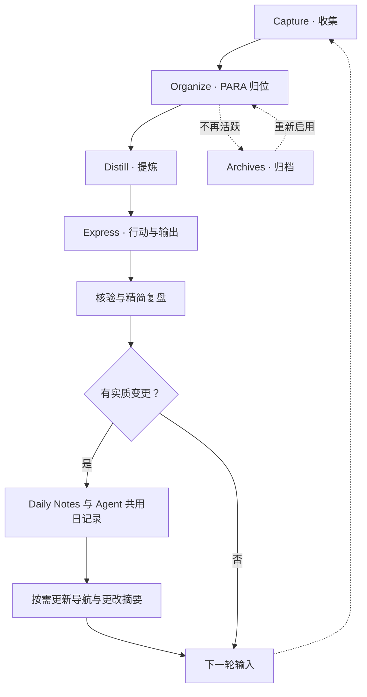

# 本库规划

本页把控知识库整体结构：组织方法、分区职责、内容归属与结构演进。

本库说明见 [[README]]，内容导航见 [[INDEX]]，核心约束见 [[AGENT]]。

## CODE：处理信息

| 阶段 | 做法 |
|---|---|
| Capture · 收集 | 快速保存资料、想法与来源，归属不明先入收集箱 |
| Organize · 组织 | 按当前行动、责任与用途归入 PARA，而非只按主题堆放 |
| Distill · 提炼 | 保留来源与上下文，提取结论和必要关联 |
| Express · 表达 | 用于项目、说明或方法；正文只维护一份 |

## PARA：组织目录

| 目录 | 用途 |
|---|---|
| `00_收集/` | 尚未处理或确定归属的输入 |
| `10_项目/` | 有明确成果和完成条件的阶段工作 |
| `20_领域/` | 需要持续维护的长期责任 |
| `30_资源/` | 可供未来参考、复用的主题资料 |
| `40_归档/` | 已完成、暂停或不再活跃的内容 |
| `90_系统/` | 库级模板、维护记录与流程图，不承载主题知识 |

## 工作流

[图源](90_系统/流程图/知识库工作流.mmd)用于编辑，下方图块用于 Obsidian 展示；修改时保持一致。

## 建立与演进

- 先检索复用已有内容；只有实际材料或明确行动出现时才建主题子目录，不预建分类树。
- 主题正文与过程材料归相应分区，具体规则就近维护；根文件只保留本职的库级概述与入口。
- **知识的流动性**：正文随用途与阶段变化，在分区间按需迁移、提炼或引用复用，不被目录固化，不为流转重复复制。
- 变动中的探索按成果拆为独立项目；稳定且需持续维护的成果归领域，不以研究完成作为建库定型的前提。
- 项目完成后复盘，再确认归档；路径或锚点变化前核对相关链接，完成后修复，不因归档丢失来源。
- 整体结构、分区职责或组织方法变化时更新本规划；新增内容只维护受影响的最近一级入口。
