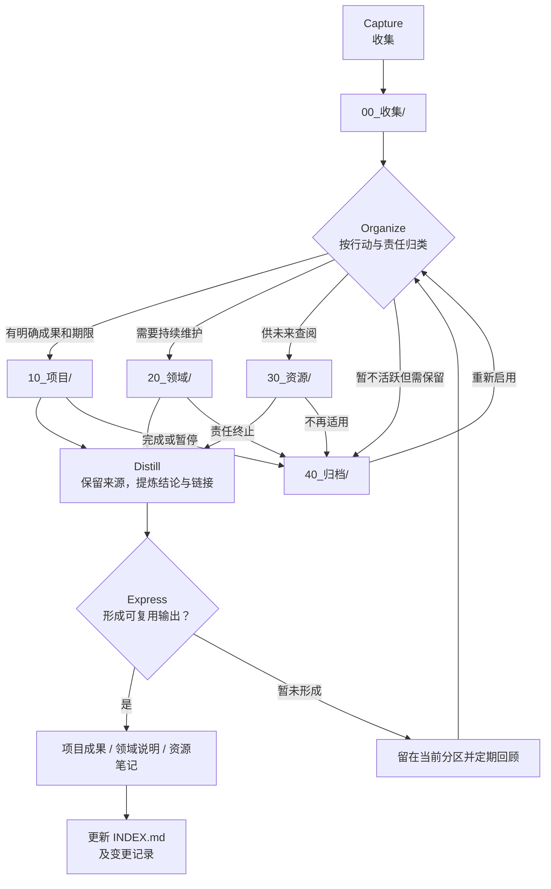

# 本库规划

## 目标

本库以 Git 根目录为 Obsidian vault 根目录，用于收集、组织、提炼和输出围绕 Git、开发工具、Vibe Coding、知识管理与 Copilot 能力生态的资料。Copilot 能力管理是跨范围清单，不以本仓库配置为边界；应涵盖工作区、用户配置、扩展提供、会话运行时，以及能核验的组织或远程来源。目录按“下一步要做什么”组织，而不是只按主题堆叠；资料来源和修改历史应可追溯。

## 工作方法

CODE 是处理信息的流程，PARA 是信息的存放位置，两者配合使用：

| CODE 阶段 | 做法 | 对应位置或结果 |
|---|---|---|
| Capture（收集） | 快速保存新想法、链接和待处理资料 | `00_收集/` |
| Organize（组织） | 根据当前行动和责任归入 PARA | `10_项目/`、`20_领域/`、`30_资源/`、`40_归档/` |
| Distill（提炼） | 保留来源，提取结论、关键词、属性和关联链接 | 对应 PARA 笔记及索引 |
| Express（表达） | 将知识用于项目、说明、方案或其他交付物 | 优先放在对应项目中，并从 `INDEX.md` 导航 |

| PARA 分区 | 判定方式 | 生命周期 |
|---|---|---|
| Projects（项目） | 有明确结果和完成条件的限时工作 | 完成或暂停后移入归档 |
| Areas（领域） | 需要持续维护、没有固定结束日期的责任 | 持续维护，失效后归档 |
| Resources（资源） | 供未来参考的主题、工具、方法和资料 | 有用时保留，无用时归档 |
| Archives（归档） | 当前不再行动但需要保留的项目、领域或资源 | 保留来源与历史，不直接删除 |

## CODE + PARA 流程图

下图展示从收集、按行动归入 PARA，到提炼和输出的流程。Mermaid 源文件保存在 [CODE_PARA_工作流程.mmd](90_系统/流程图/CODE_PARA_工作流程.mmd)；修改时保持源文件与下方图块同步。



## 目录结构

```text
00_收集/             待整理输入
10_项目/             有明确结果和完成条件的工作
20_领域/             持续维护的责任；知识管理、Agent Harness 管理和日记归此
  AgentHarness管理/
    Harnesses/
    Hooks/
    MCP/
    插件/
    技能/
    工具/
    指令/
    智能体/
30_资源/             Git、开发工具、方法论等参考资料
40_归档/             暂不活跃但需要保留的内容
90_系统/             流程图、模板、维护说明和变更记录
  流程图/
  模板/
```

`.obsidian/`、`.github/` 和 `.vscode/` 是工具配置目录，保留在根目录，不归入 PARA。根目录的 `PLAN.md`、`INDEX.md`、`AGENT.md` 分别承担规划、导航和约束职责。

Copilot 可用的 Harness、插件、技能、工具、MCP、智能体、Hooks 和指令的发现、兼容性、权限、来源与状态属于持续责任，统一登记在 `20_领域/AgentHarness管理/`，范围不局限于本库。每条记录区分工作区、用户配置、扩展提供、会话运行时、组织/远程服务等来源；厂商手册等通用参考资料可留在 `30_资源/` 并从管理条目链接。可用能力会随账号、设备、扩展、配置、权限和会话变化，索引必须记录清点来源与日期，不把单次快照宣称为永久或全球完整清单。

## 现有资料归位

| 原资料 | 归属 | 理由 |
|---|---|---|
| `git.docx`、`gitbash.docx` | `30_资源/版本控制/` | Git 与 Git Bash 参考资料 |
| `vscode.docx` | `30_资源/开发工具/` | VS Code 工具资料 |
| `vibecoding.docx` | `30_资源/方法论/` | 方法与概念参考资料 |
| `work.docx` | `20_领域/知识管理/` | 持续维护的知识库与工作记录 |

原始 DOCX 作为附件保留；需要搜索、链接或增量整理时，逐步补充 Markdown 笔记，不以转换为由丢弃原文件。

## Obsidian 兼容约定

- 保留根目录 `.obsidian/` 及现有核心插件设置；本库使用 Properties、反向链接、出链、标签、图谱、Canvas、Bases、模板和日记等功能。
- Markdown 笔记使用简洁 YAML frontmatter；属性名不重复，`tags` 使用 YAML 列表或 Obsidian 标签语法。
- 笔记之间优先使用 `[[笔记名]]` 或 `[[目录/笔记名|显示文字]]`；附件使用相对 Markdown 链接或 Obsidian 文件链接。
- 可使用 Obsidian 支持的嵌入 `![[笔记或附件]]`、Callout `> [!note]`、Canvas 与 Bases 文件；移动或重命名笔记时检查并维护已有链接。
- 文件夹和笔记名称应稳定、可读；主题子目录放在对应 PARA 分区之下，不在根目录另建主题堆放区。

## 更新与验收

每次修改本库后，在 `[[90_系统/变更记录]]` 记录日期、摘要和受影响路径；结构或入口变化同步更新 `[[INDEX]]`，组织规则变化同步更新本文件。具体执行约束见 `[[AGENT]]`。

验收标准：根目录三份约定文件存在；主要资料可从 `[[INDEX]]` 找到；PARA 分区有清晰用途；Obsidian 配置及原始资料不因整理而丢失。
